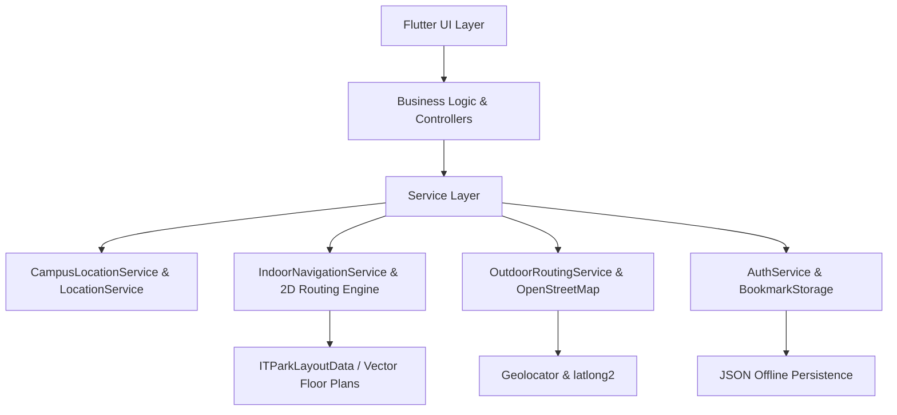

# Smart Campus Navigation 🎓📍

[](https://flutter.dev)
[](https://dart.dev)
[](https://flutter.dev/multi-platform)
[](LICENSE)

An intelligent, cross-platform indoor and outdoor campus navigation mobile application built with Flutter. Smart Campus Navigation helps students, faculty, staff, and visitors seamlessly locate buildings, explore interactive 2D floor maps, search classrooms or labs, and follow real-time turn-by-turn walking guidance.

---

## 🌟 Highlights & Key Features

### 🏢 1. Interactive 2D Indoor Floor Maps
- **Vector-Rendered Floor Plans**: High-fidelity custom vector canvas (`CustomPainter`) rendering of multi-story buildings (e.g., IT Park Ground Floor, First Floor, and Second Floor).
- **Smooth Gestures**: Native pinch-to-zoom, panning, and auto-centering powered by `InteractiveViewer`.
- **Comprehensive Room Database**:
  - **Ground Floor**: Rooms `001` through `024`, Main Entrance, North & South Staircases.
  - **First Floor**: Rooms `101` through `128`, Computer Centers (`CC01`–`CC15`), Department Library, and central staircases.
  - **Second Floor**: Rooms `201` through `227`, `CC16` Advanced AI Lab, Faculty Dining Hall, and staircases.
- **Corridor-Constrained Pathfinding**: Intelligent shortest-path routing strictly along building corridors—ensuring navigation paths never cut through solid walls or partition boundaries.

### 🗺️ 2. Outdoor Campus Map & GPS Tracking
- **Live OpenStreetMap Integration**: Interactive OpenStreetMap layer via `flutter_map` displaying campus building footprints, entry gates, pathways, and green spaces.
- **Live Positioning & Heading**: Real-time geolocation tracking with dynamic compass heading orientation.
- **Simulated / Mock Mode**: Seamless toggle between live device GPS and simulated campus coordinates for offline demonstrations and classrooms.
- **Direct Indoor Handoff**: Tap any campus building to view floor lists, occupancy, and immediately transition into 2D indoor navigation.

### 🧭 3. Turn-by-Turn Wayfinding Guidance
- Real-time step-by-step navigation instructions (e.g., *"Walk straight 25m along East Corridor"*, *"Turn left at North Stairs"*).
- Multi-floor routing prompts alerting users when to transition between floors via stairs or elevators.
- Dynamic remaining distance, elapsed time, and ETA calculations.

### 🔍 4. Fast Room & Facility Search
- Instant search bar with real-time room number matching (e.g., searching `108`, `CC`, or `Library`).
- Category filters: Classrooms, Computer Labs, Faculty Cabins, Restrooms, Dining, and Emergency Exits.
- Quick preview sheet with room details, floor level, capacity, and a 1-tap **"Navigate Here"** action.

### 🔖 5. Personal Bookmarks & Class Schedule
- Save frequently visited classrooms, labs, or library desks to **Saved Places**.
- Offline persistence of bookmarks linked directly to student profiles.
- Direct timetable integration mapping enrolled courses to specific room IDs.

### 🔐 6. Role-Based Access & Admin Portal
- **Guest Access**: 1-tap instant exploration without login credentials.
- **Student Portal**: Personalized bookmarks, department association, and course timetable navigation.
- **Admin Dashboard**: Real-time management of campus facilities, floor plan updates, room allocations, and campus-wide broadcast announcements.

---

## 🏛️ System Architecture



---

## 📂 Project Structure

```text
smart_campus_navigation/
├── android/                  # Android native project configuration
├── ios/                      # iOS native project configuration
├── lib/
│   ├── core/                 # Core theme, app constants, & mock campus datasets
│   │   ├── constants/        # App constants, mock coordinates, building metadata
│   │   └── theme/            # Material 3 color schemes, typography, and styles
│   ├── data/                 # Floor layouts, corridor graph nodes, and room geometry
│   │   └── it_park_layout_data.dart
│   ├── models/               # Domain models (Location, Floor, Room, User, Bookmark)
│   ├── navigation/           # Named route definitions and screen transitions
│   ├── screens/              # UI Screens
│   │   ├── admin/            # Admin dashboard and campus facility management
│   │   ├── auth/             # Welcome, student login, and admin login screens
│   │   ├── floor/            # 2D floor view and interactive IT Park floor explorer
│   │   ├── home/             # Main dashboard, quick actions, and search
│   │   ├── map/              # Outdoor campus map with GPS marker
│   │   ├── navigation/       # Turn-by-turn indoor & outdoor navigation screens
│   │   └── saved/            # User bookmarks and favorite locations
│   ├── services/             # Core business services
│   │   ├── auth_service.dart
│   │   ├── campus_location_service.dart
│   │   ├── indoor_navigation_service.dart
│   │   ├── location_service.dart
│   │   └── outdoor_routing_service.dart
│   ├── widgets/              # Reusable UI components & custom canvas painters
│   │   └── it_park_2d_floor_map.dart
│   └── main.dart             # Application entrypoint
├── test/                     # Automated unit and widget tests
│   └── it_park_navigation_test.dart
├── pubspec.yaml              # Project dependencies and asset definitions
└── README.md                 # Project documentation
```

---

## 🚀 Getting Started

### Prerequisites

Ensure you have the following installed on your machine:
- [Flutter SDK](https://docs.flutter.dev/get-started/install) (`>= 3.13.1` or latest stable)
- [Dart SDK](https://dart.dev/get-dart) (`>= 3.1.0`)
- [Android Studio](https://developer.android.com/studio) / Xcode (for iOS) / VS Code with Flutter extension
- An Android/iOS Emulator or physical device with USB debugging enabled (or Chrome/Edge for Web)

### Installation

1. **Clone the repository**:
   ```bash
   git clone https://github.com/KarthikeyanM006/smart_campus_navigation.git
   cd smart_campus_navigation
   ```

2. **Install dependencies**:
   ```bash
   flutter pub get
   ```

3. **Verify Flutter setup**:
   ```bash
   flutter doctor
   ```

4. **Run the app**:
   ```bash
   flutter run
   ```

*(To run on a specific device or browser, use `flutter run -d chrome` or `flutter run -d <device-id>`)*

---

## 🔑 Demo & Test Accounts

You can immediately explore the app using any of the pre-configured accounts or by entering as a guest:

| Role | Email / ID | Password | Access / Features |
| :--- | :--- | :--- | :--- |
| **Guest** | *None required* | *None* | Instant 1-tap exploration of campus map, buildings, & 2D floor plans |
| **Student** | `student@campus.edu` | `student123` | Class schedule, bookmarking rooms, personalized indoor navigation |
| **Student 2** | `priya@campus.edu` | `student123` | IT Department student profile with saved labs & dining places |
| **Admin** | `admin@campus.edu` | `admin123` | Full dashboard access, room allocation, announcements, data editing |

---

## 🧪 Running Automated Tests

The project includes unit and widget tests verifying corridor pathing algorithms, room coordinate mappings, and responsive UI rendering:

```bash
# Run all tests
flutter test

# Run the IT Park 2D navigation test suite specifically
flutter test test/it_park_navigation_test.dart
```

---

## 📱 How to Use the Navigation Features

1. **Explore Campus Map**:
   - On the **Campus Map** tab, tap any building marker (e.g., **IT Park**, **Library**, **Food Court**).
   - Tap **"View Floors"** on the bottom sheet to launch the indoor layout.
2. **Explore 2D Floor Plans**:
   - Use the **Ground**, **1st**, and **2nd Floor** chips to switch levels instantly.
   - Tap any room on the 2D layout to view its name, department, capacity, and amenities.
3. **Start Indoor Turn-by-Turn Guidance**:
   - Select your starting point (or choose *"Main Entrance"* / *"North Steps"*).
   - Select your target room (or tap any room and press **"Navigate Here"**).
   - Press **"Start Navigation"** to receive step-by-step visual guidance along the corridor path to your destination.

---

## 🤝 Contributing

Contributions are welcome! If you'd like to improve the app:
1. Fork the Project.
2. Create your Feature Branch (`git checkout -b feature/NewFeature`).
3. Commit your Changes (`git commit -m "feat: add NewFeature"`).
4. Push to the Branch (`git push origin feature/NewFeature`).
5. Open a Pull Request.

---

## 📄 License

This project is licensed under the MIT License — see the [LICENSE](LICENSE) file for details.
